<h2 align="center">Hola, soy maneuz 👋</h2>

Este ajolote vive de mi actividad en GitHub: crece, nada, come y duerme según lo que hago cada día. 
Lo dibuja <a href="https://github.com/maneuz/gitxolotl"><b>Gitxólotl</b></a>, una GitHub Action que hice. Puedes ponerle uno a tu propio perfil.

